# Attrition Bias Forecasting

**Can clinical trial attrition be forecast before enrollment? An arm-level, reason-coded benchmark from ClinicalTrials.gov.**

[](https://www.python.org/)
[](LICENSE)
[](https://clinicaltrials.gov/data-api/api)
[](#citation)

## Overview

Participants who leave a randomized trial early reduce its power. When they leave one arm more often, or for different reasons, than another, the comparison between arms can be biased. Existing forecasting work mostly predicts trial-level outcomes, such as whether a trial terminates or its overall dropout. It does not predict how attrition will differ between the arms of the same trial, or why participants leave. This repository provides:

- **A benchmark:** 16,320 randomized trials (40,336 arms) from ClinicalTrials.gov. Each arm has an attrition rate and a reason composition across 12 categories, and each trial has a differential-attrition label.
- **Baselines and a final model** trained only on information available before enrollment.
- **An evaluation of what can and cannot be forecast.** It covers prediction intervals, a recruitment-planning analysis and robustness checks.

## Key findings

All results are on the temporal test split (trials starting in 2017 or later). 95% CIs come from 1,000 trial-grouped bootstrap resamples.

| Question | Result | Verdict |
|---|---|---|
| Benchmark size | 16,320 trials / 40,336 arms (primary matched set m80) | – |
| Are reason labels accurate? | Blind human validation (n = 100): accuracy 0.980 [0.930, 0.998] (exact CI), Cohen's κ 0.976 | Reliable |
| Arm attrition rate (endpoint 1) | MAE 0.110 [0.107, 0.114] vs reference class 0.128 [0.124, 0.131]; difference −0.017 [−0.019, −0.015] | Forecastable, modest gain |
| Reason composition (endpoint 2) | Mean KL 1.104 [1.084, 1.126] vs reference class 1.236 [1.216, 1.259]; difference −0.132 [−0.143, −0.122] | Forecastable, modest gain |
| Which arm loses more participants? | Within-trial concordance 0.514 [0.499, 0.529] (FINAL, all test pairs; 0.5 = chance) | **Not forecastable** |
| Does prior evidence on the same drug help? | +0.073 [0.023, 0.124] concordance in covered, reliable trials (endpoint 3) | **Exploratory, not robust** |
| Are the 90% intervals calibrated? | Mondrian conformal coverage 0.909 [0.901, 0.916]; 0.899–0.923 in every arm-size bin | Yes |
| Does the model improve recruitment planning? | No. At matched under-recruitment it adds excess patients relative to a flat margin. | **No** |

- **Arm-level rates and reason mixes can be forecast better than a reference class, but only modestly.** Both primary endpoints hold for the m70 and m90 matched sets and for a random trial-grouped split. FINAL ranks arm attrition with Spearman 0.301 [0.274, 0.327].
- **The direction of differential attrition cannot be forecast from protocol data.** Within-trial concordance stays near 0.5 for every model: reference class 0.516 [0.501, 0.531], flat LightGBM 0.516 [0.500, 0.533], FINAL 0.514 [0.499, 0.529].
- **The prior-evidence signal is exploratory and not robust.** The +0.073 concordance gain (p = 0.005) disappears at the stricter m90 matching threshold (−0.002 [−0.060, 0.055]) and under a random trial-grouped split (+0.025 [−0.031, 0.083]). The test split was also used in earlier exploration, so this endpoint is not confirmatory.
- **Recruitment planning does not benefit from the model.** At matched under-recruitment, FINAL's conformal margin does not beat a calibrated flat margin. With 10% of arms under-recruited, FINAL needs 34.3 [2.7, 69.2] more excess patients per 1,000 required completers than the fixed rule, and 55.5 [28.5, 87.7] more than the reference class.
- **Reporting of withdrawal reasons drifts over time.** The share of withdrawals attributed to adverse events falls from 13.9% (trials starting ≤ 2007) to 3.6% (≥ 2020). The mean number of distinct reasons reported per trial falls from 3.751 to 2.974. Hidden differential attrition (total experimental-vs-control difference < 5 pp, but an adverse-event or efficacy difference ≥ 5 pp) declines from train to test under the temporal split (4.9% [4.4, 5.3] → 1.7% [1.4, 2.1]) but is flat under a random split (3.5% → 3.9%). This points to a shift in the labels, not a split artifact.
- **Robustness: the results do not depend on start year.** Refit without `start_year`, FINAL's MAE changes by +0.002 [0.001, 0.002], and it still beats the reference class on MAE (−0.016 [−0.017, −0.014]) and KL (−0.125 [−0.136, −0.115]). In per-feature-normalized SHAP, design features carry the most importance per feature (39.2–71.7% across targets). Eligibility text dominates only in aggregate, because it contributes 300 TF-IDF features.

<p align="center">
  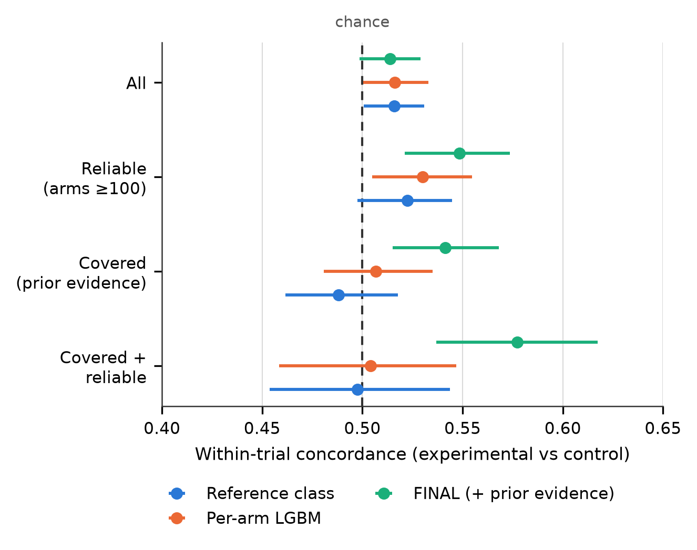
</p>
<p align="center"><em>Within-trial concordance of experimental vs control attrition (0.5 = chance). The protocol-only models stay at chance; the gain on covered, reliable trials does not hold up in the sensitivity analyses.</em></p>

<details>
<summary><b>Full test-set model comparison (all test trials)</b></summary>

| Target | Metric | n (trials / rows) | Reference class | Trial-level LightGBM | Flat LightGBM | FINAL |
|---|---|---|---|---|---|---|
| Primary arm rate | MAE | 5,424 / 13,485 | 0.128 [0.124, 0.131] | 0.112 [0.109, 0.115] | 0.111 [0.108, 0.114] | 0.110 [0.107, 0.114] |
| Primary arm rate | Spearman | 5,424 / 13,485 | 0.220 [0.195, 0.245] | 0.281 [0.254, 0.308] | 0.295 [0.267, 0.323] | 0.301 [0.274, 0.327] |
| Non-endpoint arm rate | MAE | 5,424 / 13,485 | 0.107 [0.104, 0.109] | 0.099 [0.097, 0.102] | 0.098 [0.095, 0.101] | 0.098 [0.095, 0.101] |
| Composition | mean KL | 5,367 / 12,192 | 1.236 [1.216, 1.259] | – | 1.103 [1.083, 1.125] | 1.104 [1.084, 1.126] |
| Composition | mean Aitchison | 5,367 / 12,192 | 6.861 [6.838, 6.883] | – | 6.607 [6.581, 6.633] | 6.556 [6.531, 6.583] |
| Pairwise (primary) | concordance | 5,194 / 8,488 | 0.516 [0.501, 0.531] | n/m† | 0.516 [0.500, 0.533] | 0.514 [0.499, 0.529] |
| Flag primary 10 pp (sig.) | AUROC | 5,194 / 5,194 | 0.524 [0.497, 0.556] | n/m† | 0.562 [0.533, 0.591] | 0.577 [0.549, 0.606] |
| Flag primary 10 pp (sig.) | AUPRC | 5,194 / 5,194 | 0.093 [0.082, 0.111] | n/m† | 0.108 [0.092, 0.129] | 0.112 [0.097, 0.133] |

† Not meaningful: the trial-level model predicts the same rate for every arm in a trial, so its within-trial differential is zero by construction. The reliable, covered and covered-reliable subsets, all paired tests (Holm-adjusted), conformal results by bin and the sensitivity analyses are in [results/final_summary.md](results/final_summary.md).

</details>

## Pipeline

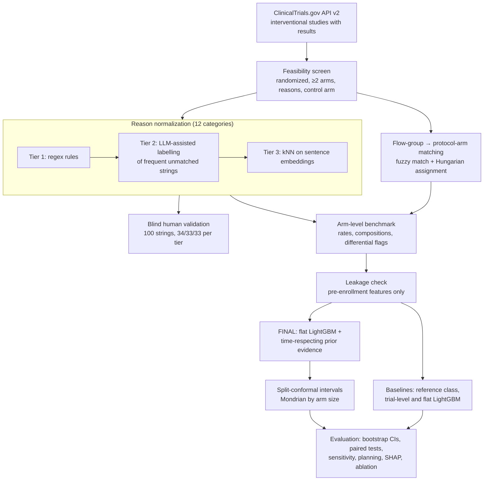

## Benchmark

### Construction funnel

| Step | Trials |
|---|---:|
| Interventional studies with posted results | 75,748 |
| Randomized with ≥ 2 arms | 47,931 |
| Usable: randomized, withdrawal reasons reported, ≥ 1 control arm | 24,473 |
| Built (≥ 2 flow groups, ≥ 1 analysable period) | 24,015 |
| All flow groups matched to protocol arms (score ≥ 80) | 19,151 |
| ≥ 1 matched control arm | 19,118 |
| Every arm started ≥ 10 | 16,349 |
| Attrition rates ≤ 1 | 16,322 |
| Known start year (**primary benchmark, m80**) | **16,320** |

Only core randomized periods are used: extension, open-label, follow-up and long-term periods are excluded unless they are a trial's only period. The denominator of each arm's rate is the number started in its first included period.

### Reason taxonomy

Raw withdrawal-reason strings are mapped to 12 categories in three tiers:
- **Rules:** anchored regex rules with a guard against compound strings.
- **LLM-assisted labelling:** the 1,505 most frequent unmatched normalized strings, up to 98% cumulative subject coverage. Labels are in [annotation/llm_labels.csv](annotation/llm_labels.csv).
- **Nearest neighbour:** the remaining strings take the category of their nearest labelled string (all-MiniLM-L6-v2 embeddings, cosine similarity). Below a similarity of 0.6, a string goes to OTHER_UNSPECIFIED.

By subjects, the tiers cover 66.5% (rules), 31.5% (LLM-assisted) and 2.0% (nearest neighbour).

<details>
<summary><b>The 12 categories</b></summary>

| Category | Definition | Primary attrition | Non-endpoint attrition |
|---|---|:-:|:-:|
| ADVERSE_EVENT | Withdrawal due to an adverse event, toxicity or intolerance | ✓ | ✓ |
| LACK_OF_EFFICACY | Insufficient therapeutic effect or treatment failure | ✓ | ✓ |
| DISEASE_PROGRESSION | Progression or relapse of the condition under study | ✓ | – |
| DEATH | Participant died | ✓ | – |
| WITHDRAWAL_BY_SUBJECT | Participant withdrew consent or chose to leave | ✓ | ✓ |
| LOST_TO_FOLLOW_UP | Participant could not be contacted; missed visits or assessments | ✓ | ✓ |
| PHYSICIAN_DECISION | Investigator or physician decided to withdraw the participant | ✓ | ✓ |
| PROTOCOL_VIOLATION | Non-compliance, protocol deviation or prohibited medication | ✓ | ✓ |
| PRE_TREATMENT_EXCLUSION | Randomized but excluded before treatment (e.g. failed entry criteria, never dosed) | ✓ | ✓ |
| SPONSOR_ADMINISTRATIVE | Sponsor decision, study or site closure, DSMB stop | – | – |
| NOT_ATTRITION | Not a dropout (e.g. completed into an extension or rollover study) | – | – |
| OTHER_UNSPECIFIED | "Other", ambiguous or mixed reasons, or a low-similarity match | ✓ | ✓ |

</details>

### Targets

| Target | Definition |
|---|---|
| Primary attrition rate (per arm) | Withdrawals in primary-attrition categories / number started (excludes SPONSOR_ADMINISTRATIVE, NOT_ATTRITION) |
| Non-endpoint attrition rate (per arm) | As above, but also excluding DEATH and DISEASE_PROGRESSION, which can themselves be trial endpoints |
| Reason composition (per arm) | Proportions over the 10 primary-attrition categories, for arms with ≥ 1 primary withdrawal |
| Differential attrition (per trial) | Experimental-arm rate minus the pooled control rate. Control = the highest-priority control type (placebo > sham > no intervention > active); experimental arms are EXPERIMENTAL/OTHER arms. |
| Significance-based flags | `flag_{primary,nonendpoint}_{5,10}_sig`: the largest experimental-vs-control difference is ≥ 5 or 10 percentage points **and** Fisher's exact p < 0.05. Group flags for adverse events and efficacy use 5 pp. |
| Within-trial concordance | Share of experimental-control arm pairs whose order of attrition is predicted correctly (0.5 = chance) |

The *reliable* subset contains arms (and trials) where every compared arm started ≥ 100.

### Pre-enrollment features and leakage policy

- **Trial design:** phase, allocation, masking, intervention model, primary purpose, number of arms, sponsor class, sex, healthy volunteers, minimum and maximum age, start year.
- **Condition:** indicator variables for top-level MeSH branches.
- **Text:** 300 TF-IDF features over eligibility criteria and brief summary, fit on the training split only.
- **Arm:** arm type, intervention types, number of interventions.
- **Prior evidence (FINAL only):** 8 features summarising earlier benchmark trials of the same normalized drug. A trial counts as evidence only if its results were first posted **strictly before** the target trial's start date; the code asserts this.

**Forbidden as features:** actual enrollment, overall status, why-stopped, completion dates, and anything from the results section. Results are used only to build labels. [`src/data/leakage_check.py`](src/data/leakage_check.py) enforces a feature allowlist on the processed tables. It also verifies that the fitted feature builders reject forbidden columns injected into their input.

### Splits

| Split | Rule | Trials | Arms |
|---|---|---:|---:|
| Train | start year < 2015 | 8,935 | 22,041 |
| Validation | 2015–2016 | 1,961 | 4,810 |
| Test | ≥ 2017 | 5,424 | 13,485 |

Hyperparameters are selected on validation. The analysis is repeated in several sensitivity variants:
- **Matched sets** m70 (16,953 trials / 42,084 arms) and m90 (15,605 trials / 38,359 arms), which use fuzzy-match thresholds of 70 and 90.
- **A random trial-grouped split** of the m80 benchmark.

## Quick start

```bash
git clone https://github.com/Pranav006svg/attrition-bias-forecasting.git
cd attrition-bias-forecasting
```

**Linux / macOS**

```bash
python3.11 -m venv .venv
source .venv/bin/activate
pip install -r requirements.txt
./run_all.sh
```

**Windows**

```bat
py -3.11 -m venv .venv
.venv\Scripts\activate
pip install -r requirements.txt
run_all.bat
```

`run_all` runs every stage in order. The raw download is about 580 MB (76 gzipped pages).

<details>
<summary><b>Per-stage commands</b></summary>

| Stage | Command | Notes |
|---|---|---|
| Download | `python -m src.data.download` | Resume-safe; writes `data/raw/` |
| Feasibility | `python -m src.data.feasibility` | `results/feasibility_summary.md` |
| Extract | `python -m src.data.extract` | Protocol and participant-flow tables in `data/interim/` |
| Normalize reasons | `python -m src.data.reasons queue` then `python -m src.data.reasons finalize` | Uses the committed Tier 2 labels |
| Build benchmark | `python -m src.data.build_benchmark` | ~20 min; writes `data/processed/` |
| Leakage check | `python -m src.data.leakage_check` | Must print `LEAKAGE CHECK PASSED` |
| Dates for prior evidence | `python -m src.data.dates` | Start and results-posting dates (ordering only) |
| Reason agreement | `python -m src.eval.agreement` | Needs the local blind key (see [docs/REPRODUCIBILITY.md](docs/REPRODUCIBILITY.md)) |
| Baselines | `python -m src.models.baselines` | `results/baselines_summary.md` |
| Descriptive analyses | `python -m src.eval.hidden_differential`, `python -m src.eval.prior_evidence_experiment` | Hidden differential, prior evidence, drift |
| Final models | `python -m src.eval.final_analysis` | Endpoints, paired tests, conformal, planning, sensitivity |
| Frontier and SHAP | `python -m src.eval.final_cache`, `python -m src.eval.recruitment_frontier`, `python -m src.eval.shap_analysis` | |
| Start-year ablation | `python -m src.eval.start_year_ablation` | ~30 min |
| Summary and figures | `python -m src.eval.final_analysis --summary-only`, `python -m src.eval.figures` | `results/final_summary.md`, `results/figures/` |

</details>

## Figures

| | |
|---|---|
| 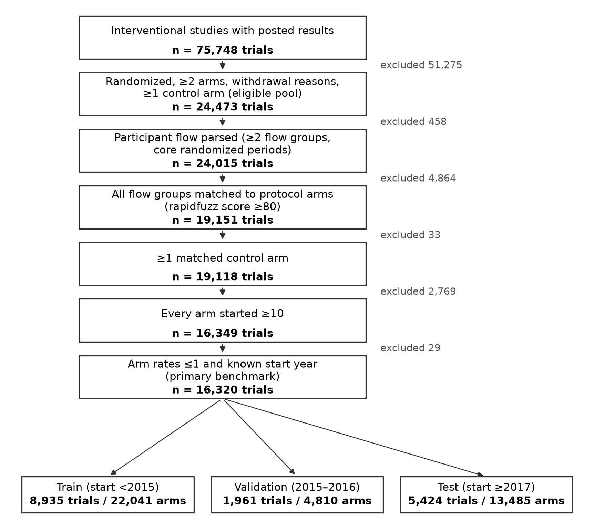 **F1.** Benchmark construction funnel and temporal split. | 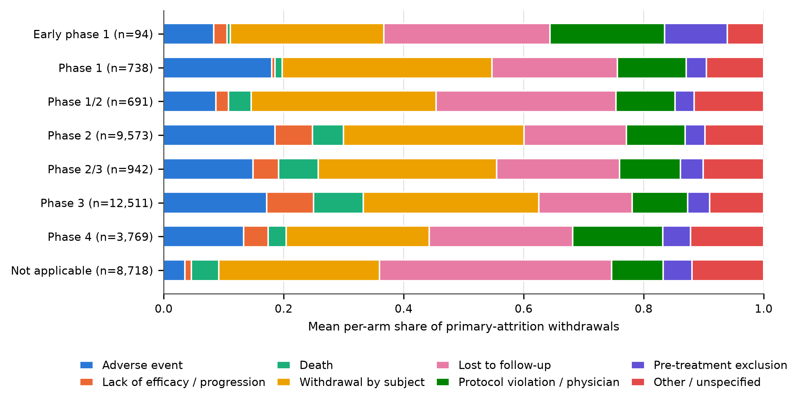 **F2.** Withdrawal-reason composition by trial phase. |
| 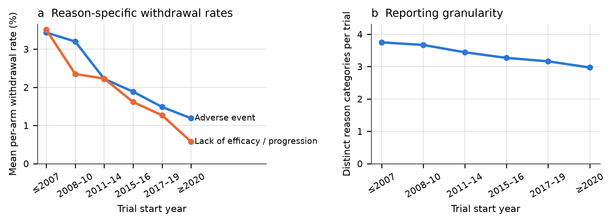 **F3.** Temporal drift in withdrawal-reason reporting by start year. | 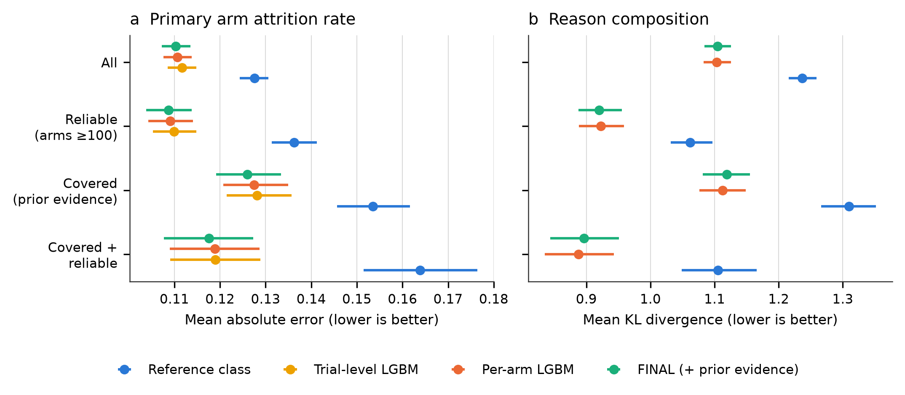 **F4.** Test-set arm-rate MAE and composition KL by model. |
|  **F5.** Within-trial concordance of experimental vs control attrition. | 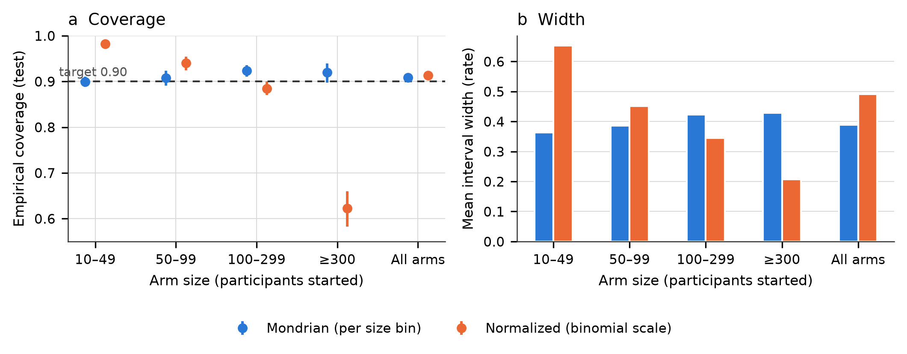 **F6.** Conformal 90% interval coverage and width by arm size. |
| 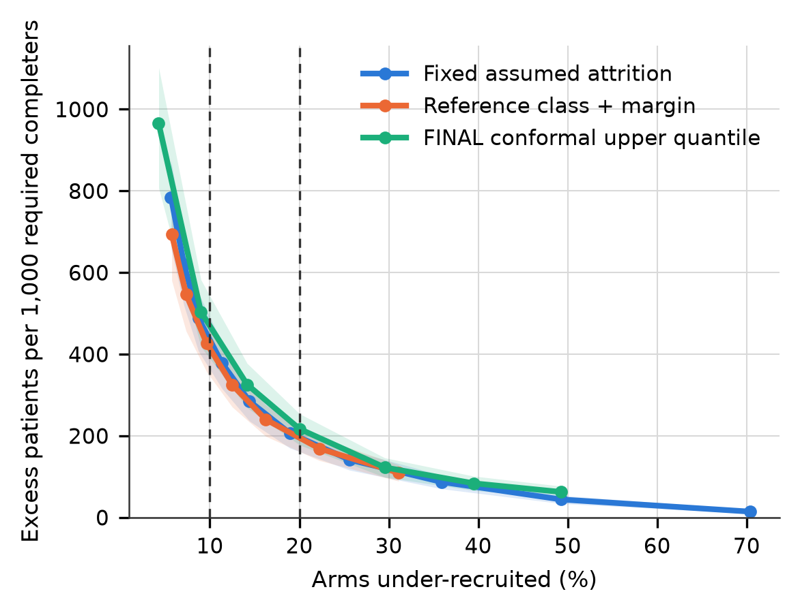 **F7.** Recruitment trade-off: under- vs over-recruitment by planning rule. | 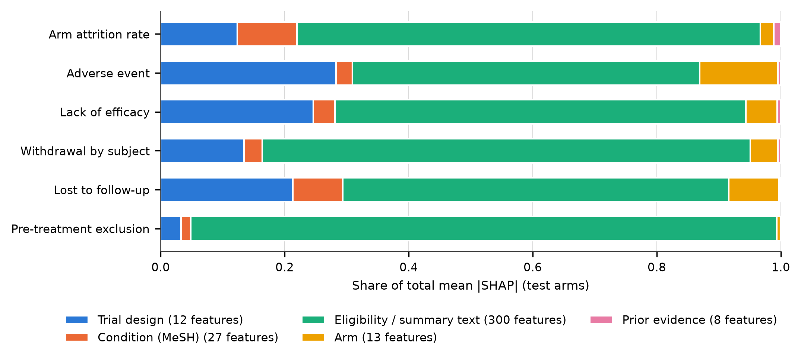 **F8.** SHAP attribution by feature family (FINAL). |
| 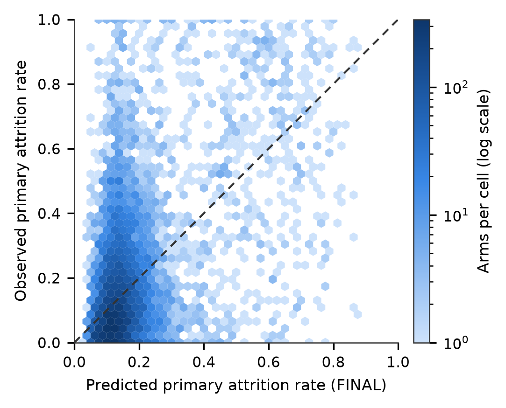 **F9.** Predicted vs observed primary attrition rate, test arms. | 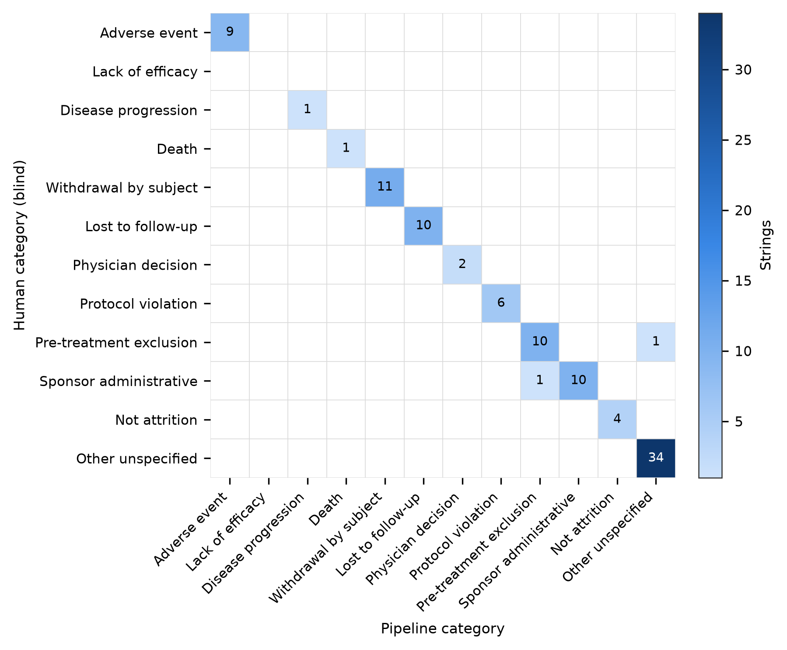 **S1.** Blind validation confusion matrix for reason normalization. |

Vector PDFs and draft captions: [results/figures/index.md](results/figures/index.md).

## Repository structure

```text
├── src/
│   ├── data/            download, feasibility, extraction, reason normalization,
│   │                    benchmark build, dates, leakage check
│   ├── features/        pre-enrollment feature builder, drug-name normalization,
│   │                    time-respecting prior-evidence features
│   ├── models/          baselines (reference class, trial-level and flat LightGBM)
│   └── eval/            metrics and bootstrap, agreement, final analysis, conformal,
│                        recruitment frontier, SHAP, ablation, figures, labelling tool
├── configs/             (reserved for configuration files)
├── annotation/          reason mapping, Tier 2 labels, blind validation sample (v2)
│                        and the unblinded v1 pilot
├── data/processed/      benchmark tables (m70 / m80 / m90) and split definitions
├── results/
│   ├── *.md             summaries (final, baselines, feasibility, agreement, ...)
│   ├── tables/          every reported number as CSV
│   └── figures/         F1–F9, S1 (PNG + PDF) and draft captions
├── notebooks/legacy/    exploratory notebooks from an earlier phase (not used by the pipeline)
├── docs/REPRODUCIBILITY.md
├── run_all.sh, run_all.bat
├── requirements.txt, CITATION.cff, LICENSE
```

## Data and licensing

- **Source:** all data come from [ClinicalTrials.gov](https://clinicaltrials.gov/), a service of the U.S. National Library of Medicine, accessed through the [API v2](https://clinicaltrials.gov/data-api/api). Use of these data is subject to the ClinicalTrials.gov [terms and conditions](https://clinicaltrials.gov/about-site/terms-conditions).
- **Raw data are not redistributed.** `src/data/download.py` fetches them into `data/raw/`, which is git-ignored.
- **Included derived files:**
  - the processed benchmark tables in `data/processed/` (`trials*.parquet`, `arms*.parquet`, `splits.json`);
  - the reason mapping and labels in `annotation/`;
  - all result tables and figures in `results/`.
- **Code license:** [MIT](LICENSE).

## Limitations

- **Observational registry data.** Labels reflect what sponsors reported, not a standardized adjudication of why participants left.
- **Reporting heterogeneity and temporal label drift.** Recent trials report fewer and coarser withdrawal reasons. Models trained on older trials face a shifted label distribution at test time.
- **Registry coverage.** ClinicalTrials.gov over-represents US and industry-sponsored trials, and only trials with posted results are included.
- **Small validation per tier.** Reason normalization was validated blind on 100 strings: n = 34 for rules and n = 33 each for the LLM-assisted and nearest-neighbour tiers. Per-tier accuracy is therefore imprecise; the LLM-assisted tier scored 0.939 [0.798, 0.993].
- **Limited prior-evidence coverage.** Exact matching of normalized drug names covers only 24.8% of test trials (all experimental arms covered); synonyms and drug classes are not linked.
- **Test-set reuse.** The test split was used in earlier exploratory analyses (baselines, feature enrichment, the prior-evidence experiment). The primary endpoints are pre-specified for the report but are **not confirmatory**. A prospective evaluation on trials that post results later is needed.

## Citation

Manuscript in preparation. Until it is available, please cite:

```bibtex
@unpublished{kumar2026attrition,
  author = {Kumar M P, Pranav},
  title  = {Can clinical trial attrition be forecast before enrollment? An arm-level, reason-coded benchmark from ClinicalTrials.gov},
  year   = {2026},
  note   = {Manuscript in preparation},
  url    = {https://github.com/Pranav006svg/attrition-bias-forecasting}
}
```

Machine-readable metadata: [CITATION.cff](CITATION.cff).

## Contact

Pranav Kumar M P · [github.com/Pranav006svg](https://github.com/Pranav006svg)
